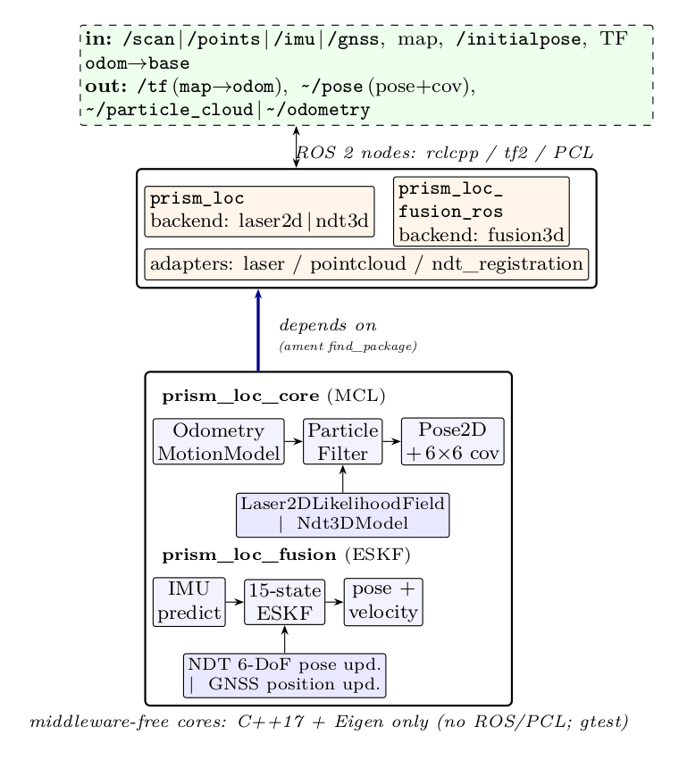
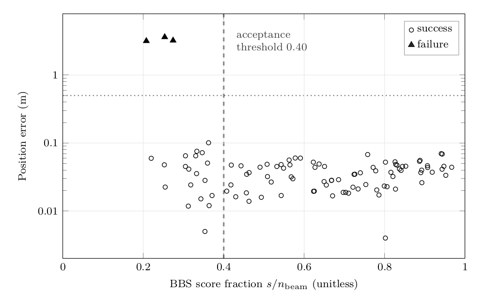
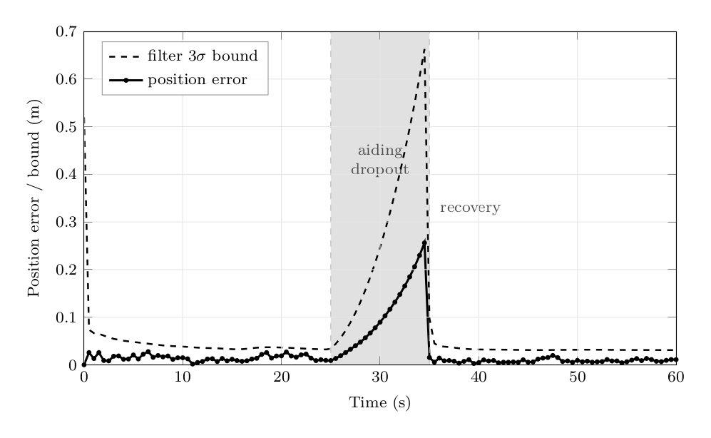
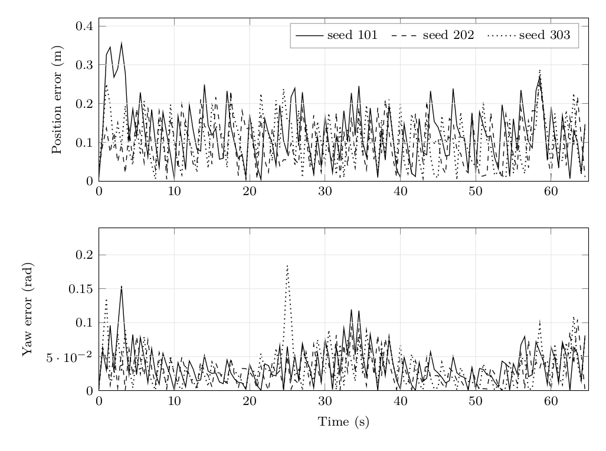

<div align="center">

# PRISM-Loc

**A pluggable LiDAR localization stack for ROS 2 Humble — three backends over
shared middleware-free estimator cores, one standard `map → odom` contract.**

[](https://github.com/kjungmo/prism_loc/actions/workflows/ci.yml)
[](LICENSE)

[](docs/paper/main.pdf)
[](https://github.com/sponsors/kjungmo)

[Overview](#overview) &nbsp;·&nbsp; [Paper](#-paper) &nbsp;·&nbsp;
[Install](#-prerequisites) &nbsp;·&nbsp; [Quick start](#-quick-start) &nbsp;·&nbsp;
[Evaluation](#-evaluation-synthetic) &nbsp;·&nbsp; [Docs](#-documentation) &nbsp;·&nbsp;
[Roadmap](#-roadmap)



</div>

`prism_loc` localizes a mobile robot inside a prior map from a **2D LiDAR**
(`LaserScan` vs `OccupancyGrid`), a **3D LiDAR** (`PointCloud2` vs a `.pcd` map),
or a **3D LiDAR fused with IMU and RTK-GNSS**. Pick a backend; the output contract
— `map→odom` TF, pose with covariance, `/initialpose` seeding — follows the
`nav2_amcl` / `hdl_localization` / `robot_localization` conventions ROS users
already know.

## 📢 News

- **2026-07** — `v0.1` released: `laser2d`, `ndt3d`, and `fusion3d` backends,
  branch-and-bound global relocalization, and a systems-paper draft with a
  fully reproducible synthetic evaluation
  ([`docs/paper/main.pdf`](docs/paper/main.pdf)).

## Overview

| Backend | Sensors | Map | Estimator | State | Global relocalization |
|---|---|---|---|---|---|
| **`laser2d`** | 2D LiDAR + wheel odometry (TF) | `OccupancyGrid` (`map.yaml`) | likelihood-field MCL, KLD-adaptive | planar (x, y, yaw) | ✅ branch-and-bound (BBS), param or on-demand service |
| **`ndt3d`** | 3D LiDAR + wheel odometry (TF) | `.pcd` point cloud | NDT-MCL (same particle-filter core) | planar (x, y, yaw) | — (`/initialpose`) |
| **`fusion3d`** | 3D LiDAR + IMU + RTK-GNSS | `.pcd` point cloud | 15-state error-state Kalman filter | full 6-DoF + IMU biases | auto-init from IMU attitude + first valid RTK fix |

**Why "PRISM"** — **P**article-filter · **R**TK · **I**nertial ·
**S**can-matching: the four ingredients this stack fuses to localize against a
prior map. The name also nods to the optics: a prism splits one beam into its
components, just as `prism_loc` splits one estimator core into multiple
sensor/observation paths — grounded in **NDT-MCL** (Saarinen et al., IROS 2013),
which showed a 3D NDT map can serve as the measurement model inside the very
same particle filter that 2D AMCL uses.

**Design principle** — all filter mathematics live in two pure C++17 + Eigen
libraries (`prism_loc_core`, `prism_loc_fusion`) with **no ROS and no PCL**,
unit-tested deterministically with gtest and a seedable RNG. `rclcpp`, `tf2`,
and PCL appear only in the two thin node packages (`prism_loc`,
`prism_loc_fusion_ros`). CI builds both paths: the bare-`cmake` cores and the
full `colcon` workspace in a `ros:humble` container. It then runs the nodes over
real ROS topics: each shipped launch file starts headless on generated maps and
[`scripts/check_param_binding.py`](scripts/check_param_binding.py) fails if any
YAML key is not declared and applied, and
[`scripts/synthetic_e2e.py`](scripts/synthetic_e2e.py) drives `laser2d` on a
synthetic world (ray-cast scans, drifting odometry) and asserts position error
≤ 0.15 m and yaw error ≤ 0.05 rad after 10 s, a `map→odom` stamp lead of
0–0.15 s, and no TF gap over 0.5 s; after a 7 s scan gap, `map→odom` resumes
within 1 s and the position error is ≤ 0.15 m from 15 s after the gap
(re-convergence measured 3–12 s; a 3 s bound is not met by the current filter).
It also asserts poses at a 0.1x simulated clock and with a coarse (10 Hz,
0.5x) simulated clock, with scans stamped ahead of odometry, no low-n_eff warning after `/initialpose` on a standing robot, and the
`/diagnostics` status for stopped scans, missing odometry, zero-stamped scans and a
stuck ROS clock. With `ndt3d.yaml` the same script drives `ndt3d` in the 3D version of
that world (16-ring lidar, prior map sampled from the same surfaces) and asserts position
error ≤ 0.5 m after 10 s and ≤ 0.25 m after 30 s, yaw error ≤ 0.05 rad, the `pose not
verified` WARN after `/initialpose` and an OK status from then on in healthy tracking,
and the `low scan-to-map match` WARN after a kidnap, for a pose off the map and for a
wrong `base_height`. This is a ROS-path check on synthetic
data, not a field result.
[`scripts/fusion_extrinsic_check.py`](scripts/fusion_extrinsic_check.py) feeds `fusion3d`
a robot that stands, or turns on the spot, with its lidar, IMU and GNSS antenna mounted
off `base_link`, and asserts the pose of `base_link` within 0.05 m and 0.02 rad, the
`/diagnostics` status when a mount is missing from TF, and, on GNSS and IMU alone with
sensor noise, height, tilt and heading within 0.15 m, 0.03 rad and 0.05 rad and a
horizontal error within twice the reported sigma; with a constant gyro bias (45 s), across a
reseed (also with the body on a slope), from a start before the antenna mount is known, over a
start and a stop, through a gap in the fixes, and from a boot with `initial_yaw` 2 rad off (also with the fixes at 1, 10 and 50 Hz, and with fixes slower than 1 Hz), height and tilt within the same
bounds, heading within 0.05 rad plus the vertical bias times the time, and a horizontal error
within 3 sigma, and the heading values and the WARN on `/diagnostics` (see
[Sensor frames](#sensor-frames-fusion3d)). CI runs it on an optimized build
of the two fusion packages; the whole script takes about 24 minutes (36 scenarios, 249 checks). `--long` adds 600 s of
standing (`gnss_stand_long`, 10 more minutes, not in CI), the same followed by a start and a stop (`gnss_stand_go`, `_b`) and the outage across a start (`gnss_gap_across_start`, `_b`, 8 minutes each).
GoogleTest cases: 50 in `prism_loc_core`, 51 in `prism_loc_fusion`, 29 in
`prism_loc`, 24 in `prism_loc_fusion_ros` (154 in total).

Run the same checks locally from a built workspace (`rosdep install` as below,
plus `sudo apt-get install python3-numpy python3-yaml`):
```bash
source install/setup.bash
bash src/prism_loc/scripts/launch_checks.sh laser2d ndt3d fusion3d
python3 src/prism_loc/scripts/synthetic_e2e.py install/prism_loc/share/prism_loc/params/laser2d.yaml
python3 src/prism_loc/scripts/synthetic_e2e.py install/prism_loc/share/prism_loc/params/ndt3d.yaml   # needs a Release build
python3 src/prism_loc/scripts/fusion_extrinsic_check.py install/prism_loc_fusion_ros/share/prism_loc_fusion_ros/params/fusion3d.yaml
```

**TF waits.** A lookup of `odom→base_link` at a scan's stamp waits for odometry to
catch up: 0.1 s of ROS time (plus up to 30 ms when the clock moved 30 ms or more in
the poll that reaches the budget), capped at 1 s of steady time. Limits: a `/clock` that changes less often
than once per second of wall time counts as frozen and is not waited on; below 0.1x
the 1 s cap ends the wait before 0.1 s of ROS time; the callback in which a clock
stops can hold up to the cap. Whether the clock is frozen is judged across waits, so
a coarse `/clock` (for example 10 Hz of sim time at 0.5x) still gets its full 0.1 s.
The buffer is polled every 10 ms as in `tf2_ros`; a live clock (about 10 ms per poll)
gets the 30 ms grace only when that poll is delayed by 30 ms or more, so a live robot
otherwise behaves as with `tf2_ros`. Smooth playback at about 3x or faster moves 30 ms
or more per poll and always gets the grace.

## 📄 Paper

The architecture, estimator cores, interface contract, and a reproducible
synthetic evaluation are described in the systems-paper draft (LaTeX sources +
PDF under [`docs/paper/`](docs/paper/)):

> **PRISM-Loc: Three LiDAR Localization Backends Behind One ROS 2 Contract,
> with Middleware-Free Estimator Cores** — [PDF](docs/paper/main.pdf)

The paper describes commit cdb81bf; later commits add tests and the `/diagnostics`
status, and with default parameters leave the estimates unchanged except that scans
and clouds with a zero header stamp are now dropped; fusion3d's `~/odometry` linear
twist is now expressed in `base_link` (it was the world frame); and fusion3d now applies
the mount of a sensor whose frame is not `base_link` (it used every input as if it were
measured at `base_link`; inputs already in `base_link` give the same values as before, see
[Sensor frames](#sensor-frames-fusion3d)).

If `prism_loc` is useful in your research, please cite it
(see also [`CITATION.cff`](CITATION.cff)):

```bibtex
@unpublished{kang2026prismloc,
  author = {Kang, Jung Mo},
  title  = {{PRISM-Loc}: Three {LiDAR} Localization Backends Behind One
            {ROS}~2 Contract, with Middleware-Free Estimator Cores},
  year   = {2026},
  note   = {Draft manuscript, available at
            \url{https://github.com/kjungmo/prism_loc} under docs/paper/},
}
```

## ⚙️ Prerequisites

**Core-only path (no ROS)** — builds/tests the two estimator libraries by
themselves. This is exactly what CI installs in
[`.github/workflows/ci.yml`](.github/workflows/ci.yml):
```bash
sudo apt-get update
sudo apt-get install -y --no-install-recommends cmake g++ libeigen3-dev libgtest-dev
```

**Full ROS path** — needed for the launch files / RViz / TF:
1. Install [ROS 2 Humble](https://docs.ros.org/en/humble/Installation.html)
   (`ros-humble-desktop` — includes `rviz2`).
2. From the workspace root (with this repo checked out at
   `<ws>/src/prism_loc`), resolve the ROS package dependencies declared in each
   `package.xml` (pulls in `nav2_map_server`, `nav2_lifecycle_manager`,
   `rviz2`, PCL, ...):
   ```bash
   rosdep install --from-paths src --ignore-src -r -y
   ```

## 🚀 Quick start

```bash
# 1. Estimator cores — build & test with the plain system toolchain (no ROS):
cmake -S prism_loc_core   -B build/core   -DPRISM_LOC_CORE_BUILD_TESTS=ON
cmake -S prism_loc_fusion -B build/fusion -DPRISM_LOC_FUSION_BUILD_TESTS=ON
cmake --build build/core   -j && ( cd build/core   && ctest --output-on-failure )
cmake --build build/fusion -j && ( cd build/fusion && ctest --output-on-failure )

# 2. Full ROS 2 Humble build (workspace):
#    place this repo at <ws>/src/prism_loc, then:
rosdep install --from-paths src --ignore-src -r -y
colcon build --symlink-install
#    For ndt3d or fusion3d on a robot add  --cmake-args -DCMAKE_BUILD_TYPE=Release :
#    built without optimization (-O0), one ndt3d filter update or one fusion3d NDT
#    registration took over a second here, and the node could not follow its inputs.
colcon test --packages-select prism_loc_core prism_loc prism_loc_fusion prism_loc_fusion_ros

# 3. Run — 2D LiDAR (MCL):
ros2 launch prism_loc laser2d.launch.py map:=/path/to/map.yaml
#    3D LiDAR (NDT-MCL):
ros2 launch prism_loc ndt3d.launch.py map_pcd_path:=/path/to/map.pcd
#    3D LiDAR + IMU + RTK-GNSS (ESKF fusion):
ros2 launch prism_loc_fusion_ros fusion3d.launch.py map_pcd_path:=/path/to/map.pcd
#    laser2d/ndt3d: click "2D Pose Estimate" in RViz to seed; fusion3d
#    auto-initializes once it has IMU attitude + a valid RTK fix
#    (or use /initialpose).
```

All three launch files accept `use_sim_time` (default `false`). Leave it
`false` against a real robot; set it `true` only when replaying a bag /
running in simulation, where pose/TF are stamped from a `/clock` topic
instead of the wall clock:
```bash
ros2 launch prism_loc laser2d.launch.py map:=/path/to/map.yaml use_sim_time:=true
```

### Verify it's working

After launching, check the node came up and is actually publishing pose/TF:
```bash
ros2 topic echo /prism_loc/pose --once
ros2 run tf2_ros tf2_echo map odom
```
(`fusion3d` runs as node `prism_loc_fusion`, so its pose topic is
`/prism_loc_fusion/pose` instead.)

Expected startup log lines (`RCLCPP_INFO`, from
[`prism_loc/src/localization_node.cpp`](prism_loc/src/localization_node.cpp) and
[`prism_loc_fusion_ros/src/fusion_localization_node.cpp`](prism_loc_fusion_ros/src/fusion_localization_node.cpp)):
- laser2d: `"prism_loc up: backend=laser2d"` then, once the map arrives,
  `"laser2d: map received (%dx%d)"` (plus
  `"laser2d: BBS global-localization matcher ready"` if
  `try_global_localization:=true`)
- ndt3d: `"ndt3d: NDT map built (%zu voxels)"` then `"prism_loc up: backend=ndt3d"`
- fusion3d: `"fusion3d: NDT map loaded (%zu pts)"` then
  `"prism_loc_fusion (fusion3d) up"`, then, once IMU+position priors land,
  `"fusion3d: initialized at (%.2f, %.2f, %.2f)"`

If any of these don't show up, or the pose/TF commands above hang or print
nothing, see [`TROUBLESHOOTING.md`](TROUBLESHOOTING.md).

### Runtime status (`/diagnostics`)

Both nodes publish a `diagnostic_msgs/DiagnosticArray` on `/diagnostics` once per
second from a wall-clock timer, so the status keeps coming when inputs stop or the
ROS clock is stuck. Status names are `prism_loc: localization` and
`prism_loc_fusion: fusion` (hardware_id = node namespace); watch them with
`ros2 topic echo /diagnostics` or `rqt_robot_monitor`.

| Level | `prism_loc` (laser2d / ndt3d) | `prism_loc_fusion` (fusion3d) |
|---|---|---|
| ERROR | no map, no scans/clouds, or no pose seed after `startup_timeout_s` (30 s); scans/clouds stopped for `max(input_timeout_s, input_timeout_periods x observed period)` | no IMU or no initialization after `startup_timeout_s`; IMU stopped; IMU not used after `startup_timeout_s` because its mount is unknown (empty `frame_id`, or no transform `base_link -> <imu frame>`) |
| WARN | odom or sensor TF lookups failing; relocalization pending, ambiguous or without candidate; effective particle count below `min_neff_fraction` (laser2d; off by default for ndt3d); ndt3d: scan-to-map match below `min_match_fraction`, or pose not verified since the last reseed; zero-stamped scans dropped; `use_sim_time` on while the ROS clock does not advance | no accepted NDT correction for `correction_timeout_s`; `odom->base_link` lost after being seen, or appearing while the map->base_link fallback was broadcast (two parents); fallback off and no odometry (no TF); IMU gaps; ROS clock not advancing under `use_sim_time`; point clouds or GNSS fixes not used because their mount is unknown (the IMU likewise, within `startup_timeout_s`) |

Values carried for monitors: `n_eff`, `particles`, `covariance_trace_xy`,
`covariance_yaw`, `input_rate_hz`, `seconds_since_last_input`,
`seconds_since_last_update`, `relocalization`, `relocalization_scans_used`,
`relocalization_scans_skipped` (laser2d/ndt3d), `match_fraction`, `match_updates_since_reseed` (ndt3d only); `imu_rate_hz`,
`imu_gaps_total`, `seconds_since_ndt_correction`, `seconds_since_gnss_correction`,
`ndt_rejected_total`, `covariance_trace_position` (the position trace of the covariance that the published pose carries), `tf_child_frame`,
`map_to_base_fallback_active`, `points_mount`, `imu_mount`, `gnss_mount` (fusion3d; each
mount reads `identity (frame base_link)`, `base_link -> lidar xyz ... rpy ...`,
`missing (frame lidar)`, `missing (empty frame_id)` or `no message yet`). A fusion3d robot without odometry that
runs on the `map→base_link` fallback by design reports OK with
`map_to_base_fallback_active=true`; it WARNs only when `odom→base_link` was seen and
then lost, or when odometry appears while the fallback was being broadcast (two
parents for `base_link`).

**ndt3d status.** The effective particle count is not a health signal for `ndt3d`: with
the NDT likelihood one particle takes nearly all the weight at every update of a healthy
run, and when no scan point falls in a map cell all particles weigh the same. `ndt3d`
therefore reports `match_fraction`: the share of the scored scan points that lie within
3 standard deviations of the NDT cell they fall in, at the published pose, averaged over
the last 5 filter updates. Three states follow from it:

| Status | When |
|---|---|
| WARN `low scan-to-map match: ...` | `match_fraction` below `min_match_fraction` (0.65) |
| WARN `pose not verified since the last reseed: N of 15 ...` | after `/initialpose` (or `set_initial_pose`), until `match_verify_updates` (15) filter updates have been judged, about 3 m of travel; a robot that stands still stays here. A wrong initial pose can match well for its first updates |
| OK `localizing` | otherwise |

**OK is not proof that the pose is right.** The signal is a classifier with these measured
rates, as shares of all filter updates of the runs named (the offline replay
[`experiments/ndt3d_replay.cpp`](experiments/ndt3d_replay.cpp): the real filter core and
`MatchMonitor` driven by synthetic clouds of the world `scripts/synthetic_e2e.py` uses, 4 seeds
per case; no part of a run left out unless stated). Regenerate them with
`experiments/ndt3d_replay_batch.py` and `experiments/ndt3d_replay_rates.py`
([`experiments/README.md`](experiments/README.md), study 7). The raw per-update output is in
`experiments/results/ndt3d_replay/`, and `rates.md` there has the same tables for threshold 0.70,
without the "not verified" state, and one row for every case of the batch, also the ones not in
this table (a cropped prior map, a pitched lidar, other `base_height` values, a second
`/initialpose` after a kidnap).

| Runs | OK | not verified | low match | OK while > 1 m off | OK while > 0.3 m off | low match while < 0.15 m off |
|---|---|---|---|---|---|---|
| healthy, exact prior map; 0.5x to 3x speed, sparser lidars (24 runs) | 89.5 % | 8.8 % | 1.6 % | 0 | 2.3 % | 0.1 % |
| healthy, 2 or 5 cm of noise on the prior map (8) | 87.8 % | 12.2 % | 0 | 0 | 0.2 % | 0 |
| healthy, scene differs from the exact map: 6 or 15 moving columns, boxes added or removed, 3 or 5 cm range noise (24) | 74.7 % | 12.1 % | 13.2 % | 0 | 3.2 % | **11.6 %** |
| the same with 2 cm of noise on the prior map (24) | 87.7 % | 12.2 % | 0.1 % | 0 | 0.8 % | 0.1 % |
| kidnapped, exact map, every update after the kidnap (8) | 8.4 % | 0 | 91.6 % | **2.7 %**, at most 4 updates in a row | 7.0 % | 0 |
| kidnapped, 2 or 5 cm map noise (12) | 24.1 % | 0 | 75.9 % | **6.8 %**, up to 15 updates in a row (7 s); the longest in time 8 s (14 updates) | 21.5 % | 0 |
| `/initialpose` 3.6 m and 1 rad off, exact map, every update (4) | 0.8 % | 8.9 % | 90.2 % | 0 (8.5 % without the "not verified" state) | 0.8 % | 0 |
| the same, 2 or 5 cm map noise (8) | 58.3 % | 10.5 % | 31.2 % | 0 (10.1 % without it) | 9.8 % | 0.2 % |
| `/initialpose` 0.3 to 1.0 m off (28) | 86.8 % | 12.2 % | 1.0 % | 0 | 4.7 % | 0 |
| pose off the map (4) | 0 | 2.0 % | 98.0 % | 0 | 0 | 0 |
| `base_height` 5 or 10 cm wrong, pose fine (8) | 0 | 0.8 % | 99.2 % | 0 | 0 | 82.2 % (a true mismatch, not of x and y) |

What these numbers say:
- **Missed.** A kidnapped robot reads OK in 3 to 7 % of the updates, for up to 8 s at a
  time on a thick (noisy) map, where lost poses match better (a single update up to 0.77;
  0.73 on the exact map) and healthy ones too (0.88 to 1.0). An offset of up to about one NDT
  cell is not detected at all: with `/initialpose` 0.3 to 1.0 m off, 7 of 28 runs were still
  0.5 to 0.87 m off for up to 6.7 s after the status had turned OK.
- **False alarms.** On an exact (thin) map, objects that are not in the map and range noise
  of a few centimetres bring a healthy run under 0.65: 15 moving columns 35 % of the
  updates, 5 boxes added and 1 removed 21 %, 5 cm range noise 20 %, 2 boxes added 3 %,
  6 columns 1 %, 3 cm range noise 0. With 2 cm of noise on the map all of these are at
  most 0.5 %.
- **The default.** At 0.70 the kidnapped misses fall to 0.9 % (exact map) and 4.6 % (noisy
  map), and the false alarms of the third row rise from 13 % to 41 %. 0.65 is kept;
  it has to be set per site.
- **Setting it.** Drive a known-good lap, read the value
  (`ros2 topic echo /diagnostics | grep -A1 match_fraction`), take its minimum and set
  `min_match_fraction` 0.03 to 0.05 below that minimum, not lower: lost poses in the
  replay reached 0.77 (0.78 on the node, below), so a threshold far below the healthy
  minimum gives the misses room.
- **A wrong initial pose** (3.6 m and 1 rad off) stayed above the threshold for the first 9 to 15
  judged updates, while 0.8 to 2.5 m off; that is why the "not verified" state exists.
- The value is that of the last filter update: it does not change while the robot stands.

Through `/diagnostics` on the node (pairing harness without strata, 75 s per run, every
status from t = 2 s on). **These runs came from an integration harness outside this repository
(it starts the node and a simulated robot and reads `/diagnostics`); no script in this repository
regenerates this table, and the replay above is the committed counterpart**:

| Runs | statuses | OK | not verified | low match | OK while > 1 m off | OK while > 0.3 m off | `match_fraction` |
|---|---|---|---|---|---|---|---|
| healthy, exact map, 4 seeds | 292 | 260 | 32 | 0 | 0 | 8 | 0.732 – 0.888 |
| healthy, 2 cm and 5 cm map noise | 146 | 130 | 16 | 0 | 0 | 0 | 0.944 – 1.000 |
| kidnapped at 40 s / 30 s, exact map (2 runs), statuses after the kidnap | 80 | 1 | 0 | 79 | 1 | 1 | 0.329 – 0.719 |
| kidnapped at 30 s, 5 cm map noise, statuses after the kidnap | 45 | 2 | 0 | 43 | 2 | 2 | 0.351 – 0.782 |
| `/initialpose` 3.6 m and 1 rad off, exact map | 73 | 0 | 3 | 70 | 0 | 0 | 0.233 – 0.677 |
| the same, 2 cm and 5 cm map noise | 146 | 80 | 14 | 52 | 0 | 22 | 0.232 – 1.000 |
| `/initialpose` 0.5 m, 1.0 m, and 1.3 m with 0.35 rad off | 219 | 194 | 25 | 0 | 0 | 18 | 0.730 – 0.876 |
| pose off the map | 73 | 0 | 0 | 73 | 0 | 0 | 0.000 – 0.000 |
| `base_height` 0.5 m too low | 73 | 0 | 0 | 73 | 0 | 0 | 0.328 – 0.462 |

Status names follow the `diagnostic_updater` convention: `<node name>: ...` with the
namespace as `hardware_id`. In a multi-robot setup either namespace or remap
`/diagnostics` per robot or give each node a unique name, or the statuses of
different robots carry the same name.

## 📊 Evaluation (synthetic)

The paper ships a **fully reproducible synthetic evaluation**: three
closed-loop experiments compile the *actual* estimator cores directly with
`g++` (no ROS, no CMake), drive them through end-to-end localization
scenarios with fixed seeds, and write the CSVs committed under
[`docs/paper/data/`](docs/paper/data/). Every number and figure below is
recomputable from those drivers ([`experiments/`](experiments/)); a committed
guard script ([`docs/paper/check_numbers.py`](docs/paper/check_numbers.py))
asserts the quoted statistics still trace to the CSVs. This is a correctness
and behavior demonstration on synthetic data — **not** a field-accuracy
benchmark; evaluation on public datasets is on the [roadmap](#-roadmap).

| | |
|:---:|:---:|
|  |  |
| **Global relocalization (BBS)** — 100 kidnapped-robot queries: **97 % success**, median error **0.037 m / 0.48°**, zero false accepts at the score threshold, median full-map latency 37.65 ms. | **ESKF under aiding dropout** — position RMSE **0.016 m → 0.125 m → 0.009 m** before/during/after a 10 s IMU-only blackout; the filter's 3σ bound stays above the true error throughout. |

<div align="center">


**MCL tracking** — 65 s closed loop, three seeds: steady-state mean position
error **0.105 m**, mean yaw error **1.8°**; KLD resampling shrinks the
particle set 2000 → 500 (4× fewer likelihood evaluations) after convergence.
</div>

## 🗺️ Building a map

**laser2d** consumes a standard Nav2 2D map (`map.yaml` + `.pgm`). Build one
with [`slam_toolbox`](https://github.com/SteveMacenski/slam_toolbox) while
driving/teleoperating the robot through the space, then save it with
`nav2_map_server`'s saver once the map looks complete:
```bash
ros2 run nav2_map_server map_saver_cli -f /path/to/map
#   -> writes /path/to/map.yaml + /path/to/map.pgm; point laser2d.launch.py's
#      map:= argument at the .yaml.
```

**ndt3d** / **fusion3d** consume a single prior `.pcd` point cloud
(`map_pcd_path`). `prism_loc` itself is localization-only — it does not ship a
mapping node — so build the map with a separate 3D SLAM/registration pipeline,
then hand the result to `prism_loc`:
1. Drive the robot through the space once, recording the raw cloud (and TF)
   to a bag: `ros2 bag record -o mapping_bag /points /tf /tf_static`.
2. Post-process the bag with a 3D SLAM/scan-registration pipeline (e.g.
   a LiDAR-inertial odometry package or PCL registration) to produce
   one globally-consistent point cloud.
3. Save that merged, downsampled cloud as a single named `.pcd` file (e.g.
   `pcl::io::savePCDFileBinary("/path/to/map.pcd", merged_cloud)`).
4. Point `map_pcd_path:=/path/to/map.pcd` at it for `ndt3d.launch.py` /
   `fusion3d.launch.py`.

### Global localization: counting only scans taken after the robot moved

Verification (`bbs_verify_scans`, default 9) multiplies the evidence of every
scan it counts. The shipped values were selected in
[`experiments/bbs_verify.cpp`](experiments/bbs_verify.cpp) with **0.3 m** of travel
between scans, but by default the node counts every incoming scan. A stationary
robot then feeds near-identical scans: no new information arrives, yet the
posterior of whichever hypothesis the first scan slightly preferred grows until it
is committed (the unit test
`RelocVerifierMotionGate.StationaryRepeatsCommitToTheWrongRoomWithoutGate`
reproduces a commit to the wrong one of two aliased rooms). Setting

```yaml
bbs_verify_min_translation: 0.3   # m, the step the defaults were selected with
bbs_verify_min_rotation: 0.3      # rad, so in-place turns also count
```

makes a scan count only after that much odometry motion since the last counted
one; the verifier then stays pending while the robot stands still and decides on
the move. Meanwhile `/diagnostics` WARNs `"relocalization pending: waiting for motion
(N scans skipped)"` and reports `relocalization_scans_used` /
`relocalization_scans_skipped`. The code default is `0.0` and the shipped YAML does
not set these keys (every scan counts, the v0.1 behaviour) until this is adopted as
the default.

## 🔌 Interface

| Backend | Package | Input | Output |
|---|---|---|---|
| **laser2d** | `prism_loc` | `/scan`, `/map`, `/initialpose`, TF `odom→base` | `/tf` `map→odom`, `~/pose`, `~/particle_cloud` |
| **ndt3d** | `prism_loc` | `/points`, `map.pcd`, `/initialpose`, TF `odom→base` | same |
| **fusion3d** | `prism_loc_fusion_ros` | `/points`, `/imu`, `/gnss` (NavSatFix), `map.pcd`, `/initialpose`, TF `base→sensor` for every input not in `base_link` | `/tf` `map→odom`, `~/pose`, `~/odometry` |

All backends also publish `/diagnostics` (see [Runtime status](#runtime-status-diagnostics)).
`fusion3d` broadcasts `map→base_link` instead of `map→odom` while no
`odom→base_link` transform exists (`map_to_base_fallback`, default `true`). If wheel
odometry or an EKF publishes `odom→base_link` and may start after `fusion3d`, set
`map_to_base_fallback: false`; otherwise `base_link` briefly has two parents in the
TF tree. `~/odometry` (`nav_msgs/Odometry`, `frame_id` = `map`, `child_frame_id` =
`base_link`) carries its linear twist in `base_link`, as the message definition
specifies; the angular twist is not filled.

### Sensor frames (`fusion3d`)

The pose `fusion3d` estimates and publishes is that of `base_frame` (`base_link`). Each
input is taken to be measured in the frame its `header.frame_id` names; `points_frame`,
`imu_frame` and `gnss_frame` replace that name when set (for a driver that leaves
`frame_id` empty or wrong).

| Input | Frame is `base_frame` | Any other frame | What is applied |
|---|---|---|---|
| `/points` | used as it is, no TF needed | transform `base_frame → frame` must be on TF | all 6 DoF: registration starts from and returns the pose of the lidar, `T_map_base = T_map_lidar · T_base_lidar⁻¹` |
| `/imu` | used as it is, no TF needed | transform must be on TF | rotation only: angular velocity and specific force are rotated into `base_frame` |
| `/gnss` | used as it is, no TF needed | transform must be on TF | translation only (the lever arm `t`): the fix is fused as the position of the antenna, `p + R·t`; the attitude uncertainty enters its innovation covariance through `∂/∂θ = −R[t]×` |

- **Not compensated.** The IMU's lever arm: the specific force is the one at the IMU, which
  differs from the one at the `base_frame` origin by `α × r + ω × (ω × r)` (0.3 m/s² for
  r = 0.3 m at 1 rad/s); put `base_frame` near the IMU if that matters. The lidar's
  measurement noise (`pose_pos_std`) is used unchanged for the pose of `base_frame`: with
  a lever arm `t`, an error `δ` in the registered attitude adds about `|t|·δ` of position
  error that the filter does not model.
- **GNSS antenna off `base_frame`.** The fix is the position of the antenna, `p + R·t`, fused with the full Jacobian. With the
  antenna at `base_frame` nothing changes. With a lever arm, the roll and pitch variance at the start and at every reseed is the
  accelerometer's (about 1e-4 rad²), and `/initialpose` takes roll and pitch from the accelerometer at the heading of the message
  (RViz sends a level attitude; on a slope that is wrong by the slope). One antenna and an IMU observe this (‖t_xy‖ is the
  horizontal part of the arm):

  | The robot | position of `base_link` | roll, pitch | heading | vertical gyro bias |
  |---|---|---|---|---|
  | stands, creeps, or drives straight at constant speed | only to a circle of radius ‖t_xy‖ around the antenna | yes | **no** | no |
  | accelerates, brakes, or turns at speed | yes | yes | yes, through the IMU | with the heading |
  | spins on the spot | yes, through the sweep of the antenna | yes | weakly | weakly |

  The filter follows the table with these rules. Each has a measured failure behind it (study 6, `experiments/README.md`; synthetic
  runs on the real filter core; `tz` = tilt over 0.05 rad or height error over 0.5 m; the formulas are in
  [`SPEC_fusion.md`](SPEC_fusion.md)).
  1. **Consider states.** Heading and vertical gyro bias enter the innovation covariance and are not corrected. Roll, pitch, the
     horizontal gyro biases, accelerometer bias, velocity and position are corrected. A plain update everywhere has `tz` in 408 of
     1,152 runs of suite `hsg` (all rules: 49).
  2. **Bound.** The heading standard deviation that one update sees is at most 0.35 rad (`lever_heading_sigma_max`). Without it
     the heading variance of a standing robot grows without limit, and tilt and height diverge after minutes: 192 of 192 runs of
     900 s and 1,800 s standing, 0 of 192 with the bound.
  3. **Release.** While a decaying integral of the horizontal specific force exceeds 1.0 m/s (`lever_release_dv`), the update is the
     full one and the bound is off. A straight drive at constant speed and a spin keep it closed. Against a speed gate, the release
     cuts `tz` from 1,882 to 880 of 4,200 runs.
  4. **Shadow.** The filter keeps the unbounded spread of the heading and the vertical gyro bias (`heading_sigma_rad`; the pose
     covariance carries it). `heading_sigma_used_rad` is the bounded one.
  5. **Alignment.** While the shadow is over 1 rad, a start or a stop of 0.25 m/s or more gives the heading: it rotates by the angle
     between the change of velocity of the IMU and that of the antenna fixes (`heading_source: motion`, any error up to ±π).
     Velocities use spans of seconds, scaled by the measured fix period. The alignment refuses a window with a gap in the fixes
     (after an outage across a start: `tz` 68 to 11 of 288 runs) and a fast turn. Without the shadow and the alignment, 375 of
     1,152 runs of `hsg` have `tz`; with them and rule 6, 26 (49 with rule 7, see the limits).
  6. **Blind.** While the heading is not known and not alignable (standing, turning on the spot), the update leaves roll and pitch
     out of the lever term and counts the circle of the lever as noise. Without it, 81 runs of `hsg` have `tz`; with it, 26.
  7. **Unknown start.** With a lever arm and no heading source (no `/initialpose`, no lidar yet, `initial_yaw_known: false`) the
     heading is a guess, and the filter starts it with the spread of π/√3 rad. `tz` in `hboot` falls from 219 to 77 of 576 runs.
     `/initialpose`, the lidar or `initial_yaw_known: true` start with the filter's own spread.
  8. **Outage spread.** After an outage with the heading unknown, the first update adds a tenth of the spread that the dead-reckoned
     velocity and position have (`lever_outage_spread`). Short outages at the first start: the mast diverges in 16 of 640 runs
     without it, 0 with it; antennas A and B have `tz` in 83 of 1,280 runs without it, 32 with it.

  **Supported GNSS fix rate: 1 to 100 Hz** for the alignment (rules 5 and 7). The fixes are kept by time, so the rate does not
  matter above 1 Hz. Antennas A and B, 272 boot and stand-then-go runs per rate, the fixes on the second on which the motion starts: `tz` is 0 at 1, 5, 10, 20, 50 and
  100 Hz and 1 at 2 Hz (other phases of the fix period: see the 1 Hz limit below). From 0.8 to 1 Hz (a fix every 1.05 to 1.25 s) the alignment runs and finds the heading less often (`tz` 5 and 4 of 272 at
  0.83 and 0.91 Hz, over 1.5 m horizontal in 35 and 19); `/diagnostics` reads `degraded` and WARNs. Under 0.8 Hz the alignment does
  nothing, the start is not marked unknown, and `/diagnostics` reads `unsupported` and WARNs (0.5 Hz: `tz` 105 of 272).

  **What you see on `/diagnostics`** (new values; none changes an existing one):

  | State | `heading_source` | `heading_sigma_rad` | `heading_capped` | `lever_release` | Status |
  |---|---|---|---|---|---|
  | filter not initialized | `none` | `n/a` | `false` | `n/a` | as before |
  | antenna at `base_frame` | the last source | the filter's | `false` | `n/a` | as before, never the heading WARN |
  | lever arm, under 30 s since the start, no `/initialpose`, `initial_yaw_known` false | `none` | 1.8 and growing; `heading_sigma_used_rad` 0.35 | `true` | `closed` | OK; `lever_blind` `true` |
  | lever arm, under 30 s since the last `/initialpose`, or `initial_yaw_known` true | `initialpose` or `none` | 0.71 and growing; used 0.35 | `true` | `closed` | OK |
  | lever arm, 30 s or more with no heading source | the last source | grows (6 rad after 600 s); used 0.35 | `true` | `closed` | **WARN** `heading not observed: GNSS and IMU only for N s ...` |
  | start or stop of 0.25 m/s or more | `motion` | falls to 0.35 and below | `false` | `closed` or `open` | no heading WARN |
  | turn at speed | unchanged | falls below 0.35 | `false` | `open` | no heading WARN |
  | lidar corrections accepted | `lidar` | about 0.03 | `false` | `closed`; `open` while accelerating | OK |
  | fixes stop for more than 2 s | unchanged | unchanged | `false` | unchanged | the heading WARN clears; its 30 s start again with the first fix |
  | fixes every 1.05 to 1.25 s | as without the alignment | 1.8 while unknown | as before | as before | **WARN** `GNSS fixes come every N s (slower than 1 Hz) ...`; `heading_align_rate` `degraded` |
  | fixes slower than 0.8 Hz | as without the alignment | the filter's own | as before | as before | **WARN** `GNSS fixes come every N s (slower than 0.80 Hz) ...`; `heading_align_rate` `unsupported` |

  `gnss_fix_period_s` is the median interval of the last lever-arm fixes (`n/a` before the third). `heading_align_rate` is `supported`,
  `degraded` or `unsupported` (`n/a` before the sixth fix and for a zero lever). `covariance_trace_position` is the position trace of
  the covariance that the published pose carries, the heading spread included. `lever_blind` is `true` while rule 6 applies.
  `gnss_only_s` counts the seconds since the last heading source.

  **Limits, with counts** (synthetic runs; no real robot):
  - **The heading is not estimated while the robot stands, drives at constant speed or turns on the spot.** It drifts with the vertical
    gyro bias (0.1 rad per minute for each 0.1 deg/s). The position of `base_link` can be wrong by up to `2·|t_xy|` (1.0 m for a 0.5 m
    arm). After a turn on the spot the heading is off by over 0.5 rad in 269 of 384 runs of `hsg` (268 in `hsgv`; zero lever: 106 and 97
    of 128), and `base_link` is over 1 m from the truth in 34 of 384. Read `heading_sigma_rad`, not `heading_sigma_used_rad`.
  - **The 1.5 m mast (no horizontal arm) gains little.** It ends at the level of the zero-lever filter. In 640 short outages at the
    first start it has `tz` in 132 runs (zero lever: 226). In the hardest cell (stand 900 s, 0.2 deg/s) it has `tz` in 123 of 160 runs
    against 61 for the zero lever, 73 of them with no `tz` in the zero-lever run. In the long outages: 17 of 192 against 29. In `hboot`: 76 of 192.
  - **A tight circle that starts during an outage.** Antenna A (0.5 m arm) on a circle of 6 m radius: 32 of 128 runs are over 1.5 m and
    64 of 128 have the heading off by over 0.5 rad; antenna B (0.36 m): 0 and 11 of 128. The alignment refuses a body rate over `0.125 m/s / |t_xy|`.
  - **An alignment right after an outage can be wrong by a radian** under a spread of 0.35 rad; the next release can turn the heading
    the wrong way (the replica of `gnss_gap_across_start`: 1 of 300 seeds fails with the shipped spread, 0 without, 4 with the whole).
  - **A known good heading costs something when the filter is told to doubt it.** With a right `initial_yaw`, the alignment adds its own
    error: `hsg` `tz` 49 against 26 without the unknown start. Set `initial_yaw_known: true` or send `/initialpose`.
  - **1 Hz is the edge of the supported rate, and it has a tail.** With the fixes 0.1 to 0.9 s after the second on which the motion starts,
    26 of 2,720 runs have `tz` and the largest height error is 1.45 m (phase 0, which the rate table above uses: 0 of 272). The node scenario
    `gnss_boot_wrong_yaw_1hz` shows it: of 30 runs, 27 end 0.06 to 0.11 m high and 3 end 2.7 to 3.3 m high (heading off by up to 0.5 rad).
  - **A vibrating platform** with over 0.15 m/s² of accelerometer noise per axis opens the release without acceleration; raise
    `lever_release_dv` (a compile-time default, not a node parameter).
  - **Confidence.** The heading and horizontal covariance of an update are optimistic once the true heading error is over the bound
    (by construction); the published pose covariance uses the honest spread.
  - Not measured: a real robot, slopes under motion, GNSS multipath or jumps, driving under 1 m/s, a bound under 0.35 rad.

  The node check `scripts/fusion_extrinsic_check.py` runs the scenarios of this section on real ROS topics: a constant gyro bias, a
  reseed (also on a slope), a start before the mount is known, a start and a stop, a gap in the fixes, a boot with `initial_yaw` 2 rad
  off at 1, 5, 10 and 50 Hz, fixes slower than 1 Hz, and (not in the default run) 600 s of standing, the same followed by a start
  and a stop, and an outage across a start. The bound of each scenario comes from repeated runs, stated in the script. The raw output
  is [`experiments/results/eskf_lever/node_checks.txt`](experiments/results/eskf_lever/node_checks.txt); all tables, every run:
  [`report.md`](experiments/results/eskf_lever/report.md).
- **Missing mount.** With an empty frame name or no transform, that input is not used
  (nothing is assumed): the log says so every 5 s and `/diagnostics` reports
  `point clouds not used: ...`, `GNSS not used: ...` (WARN) or `IMU not used: ...` (WARN
  within `startup_timeout_s`, ERROR after: without the IMU there is no pose). The status
  clears with the first message after the transform appears.
- **Lookup.** The latest available transform is used (a mount is rigid; nothing is waited
  for), read again once per second, and kept if TF later loses it. A sensor on a moving
  joint is not supported.
- **Unchanged case.** Data already in `base_frame` (the frame name equals `base_frame`, or
  the transform on TF is exactly the identity) goes through no arithmetic at all; the
  values are bit-identical to those of earlier versions
  (`prism_loc_fusion_ros/test/test_extrinsic.cpp`).
- **Changed case.** Earlier versions ignored `frame_id` and used every input as if it were
  measured at `base_frame`. A robot whose frames differ from `base_frame` and that relied
  on that gets the old behaviour with `points_frame`, `imu_frame`, `gnss_frame` set to
  the value of `base_frame`.

## 📚 Documentation

| Document | Contents |
|---|---|
| [`docs/paper/main.pdf`](docs/paper/main.pdf) | Systems paper: architecture, estimator cores, interface contract, synthetic evaluation |
| [`PARAMS.md`](PARAMS.md) | Every `laser2d`/`ndt3d`/`fusion3d` parameter, its default, and its meaning |
| [`TROUBLESHOOTING.md`](TROUBLESHOOTING.md) | Symptom → cause → fix for the common failure modes, with the `/diagnostics` message each one produces |
| [`SPEC.md`](SPEC.md) / [`SPEC_fusion.md`](SPEC_fusion.md) | Full design specifications |
| [`experiments/README.md`](experiments/README.md) | How to rebuild and rerun the synthetic evaluation |

## 🧭 Roadmap

`v0.1` ships 2D likelihood-field MCL and 3D NDT-MCL (planar x, y, yaw), plus a
3D LiDAR + IMU + RTK-GNSS error-state Kalman fusion (`fusion3d`) with full
6-DoF state and IMU-bias estimation. The `laser2d` backend self-initializes
via branch-and-bound (BBS) global localization with no `/initialpose` (param
`try_global_localization`, on-demand service `~/global_localization`): the
top-K distinct BBS modes of the first scan are verified over several
odometry-chained scans, and the pose is committed only when one hypothesis
dominates the posterior; otherwise the node reports the place as ambiguous
instead of re-seeding (`bbs_verify_*` params). Planned:

- [ ] Quantitative field evaluation (ATE/RPE) on public datasets
- [ ] 3D global localization for `ndt3d` / `fusion3d`
- [ ] Tight LiDAR–IMU time-offset estimation
- [ ] Sample map + bag pair for a known-good first run

## 🙏 Acknowledgements

`prism_loc` claims no new estimator theory — it stands on well-known work and
conventions: **MCL / AMCL** (Dellaert, Fox, Thrun et al.; `nav2_amcl`),
**NDT & NDT-MCL** (Biber & Straßer; Magnusson; Saarinen et al.),
**branch-and-bound scan matching** (Olson; Hess et al., Cartographer),
**error-state Kalman filtering** (Solà), and the ROS interface patterns of
[`robot_localization`](https://github.com/cra-ros-pkg/robot_localization) and
[`hdl_localization`](https://github.com/koide3/hdl_localization). See the
paper's Related Work section for the full positioning.

## 💛 Sponsor

If `prism_loc` saves you time, consider
[sponsoring](https://github.com/sponsors/kjungmo). Sponsorship funds
maintenance, new features, and faster issue response. Backers will be
acknowledged here — thank you.

## License

Apache-2.0.
